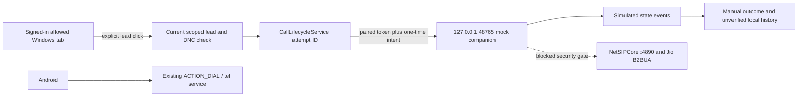

# Windows calling pilot architecture

17 October 2026 IST. **Mock-only implementation; real-Jio mode blocked.** See [security review](UPSTREAM-SECURITY-REVIEW.md). No hosted schema migration, auth change, carrier secret, recording or production activation.

## Decision and implemented boundary

`CallProvider`, `DialIntent`, status/events and `NativeDialerProvider` separate native dispatch from `WindowsJioProvider`. The latter's name describes the intended provider, **not** successful Jio integration. `LOCAL_JIO_ENABLED=false` is immutable; the companion rejects every mode except `mock`, has no SIP process launch or real-engine network code, and needs no admin privileges.

Primary tested handoff: explicit browser fetches to a fixed loopback HTTP endpoint in a local Chromium development context. Production headers and production meta CSP do not permit this endpoint; development policies permit only `http://127.0.0.1:48765`. No microphone permission is added. HTTPS Preview/Production → Windows LNA/PNA/mixed-content/custom-protocol behavior is **not verified**. A later protocol-handler fallback must carry an opaque one-time intent, require native confirmation, and be independently tested on Windows; none is registered or silently selected by this build. Hosted click-to-call remains disabled/blocked. Manual phone-dialer use remains available after explicitly disabling the pilot.

## Pairing and policy

Opt-in requires `VITE_WINDOWS_CALLING_MOCK=1`, an exact `organization:user` entry in `VITE_WINDOWS_CALLING_MOCK_SCOPES`, active authorized CRM profile, Windows user agent and an approved local/disposable or Staging public backend. Production endpoint/key, service-role keys and unidentifiable hosted keys fail closed. A user-agent check is a UI platform filter, **not authorization**. The local operator independently starts the companion with the allowed user/organization/role and exact origin, then enters its random 256-bit, two-minute, single-use code in Settings. Self-asserted browser identity is acceptable only for this incapable-of-calling demo; a real mode additionally needs an independently validated CRM session/role attestation and per-user Windows IPC isolation.

Pair tokens, device and session IDs live in tab memory, expire after ten minutes, and have a thirty-second renewable lease. HTTP requires exact Origin, Host, loopback peer, JSON content-type and token/scope; no wildcard CORS, cookie auth or GET mutation. `/intent` binds normalized number/lead/attempt to server nonce for 15 seconds; `/dial` consumes it even on denial. Explicit click, current scoped lead authorization/DNC check, no offline queue, one-call lock, attempt deduplication, 3-second cooldown, 50 attempts per India day and a bounded HTTP request budget apply. The local policy can be lowered, never raised above 50 in this pilot. Budget state is memory-only and resets when mock process restarts; it is **not a persistent real-carrier usage control**.

Refresh/logout/disable/page close revoke or abandon pairing. Network loss can prevent immediate unpair: the lease bounds companion cleanup to thirty seconds. Sleep/reconnect does not redial; a new code requires restarting the companion. Mock requests in flight cannot become carrier calls. This best-effort lease is not an absolute no-call-after-logout guarantee for future live tools, so live mode cannot be enabled merely by flipping a flag.

## Facts, history and provenance

`CallLifecycleService.beginWindowsMock` reloads the accessible lead, rejects DNC/deleted records and creates one pending attempt. Duplicate clicks cannot replace it. Native app-state resume ignores mock attempts. Only correlated, ordered, recent mock events affect the attempt; mock events never become verified native evidence. A refreshed attempt is interrupted and offers manual outcome/skip, never a new dial.

Mock completion is one Dexie transaction across records, lead count, append-only activity and outbox, with deterministic call/audit IDs. Outcomes/remarks are retained; the record is `DIAL_ATTEMPT`, `UNVERIFIED`, duration zero, answeredAt null, with a visible MOCK prefix and activity provenance. User-selected lead status, last-contact time, reported duration and follow-ups are not advanced as if a real call occurred. This is intended for synthetic test leads only. No new hosted columns or migrations. Android initiation/resume/completion behavior remains in its existing path.

NDJSON command encoder/state decoder are audited-source contract helpers tested against isolated ephemeral mock TCP. They include source-required `server` on `call`, bound frames and omit remote identifiers from sanitized events. They are **not a production NetSIP adapter**: no registration credentials or connection to :4890 are shipped. Incoming calls, audio playback, recording and answer controls are disabled.
